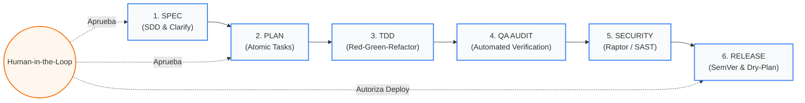
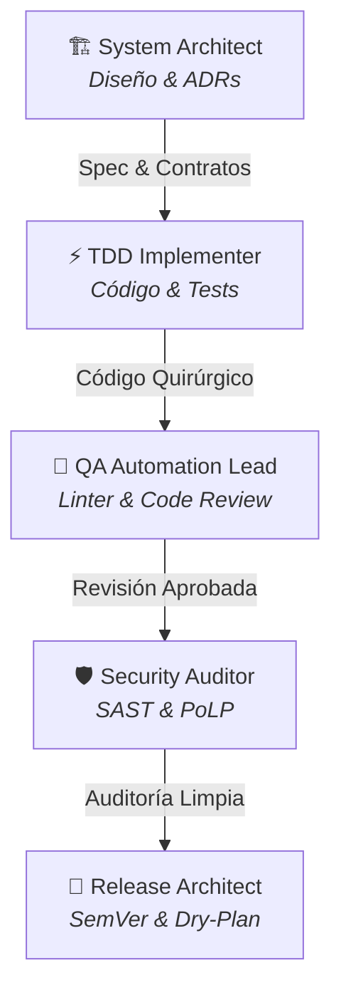
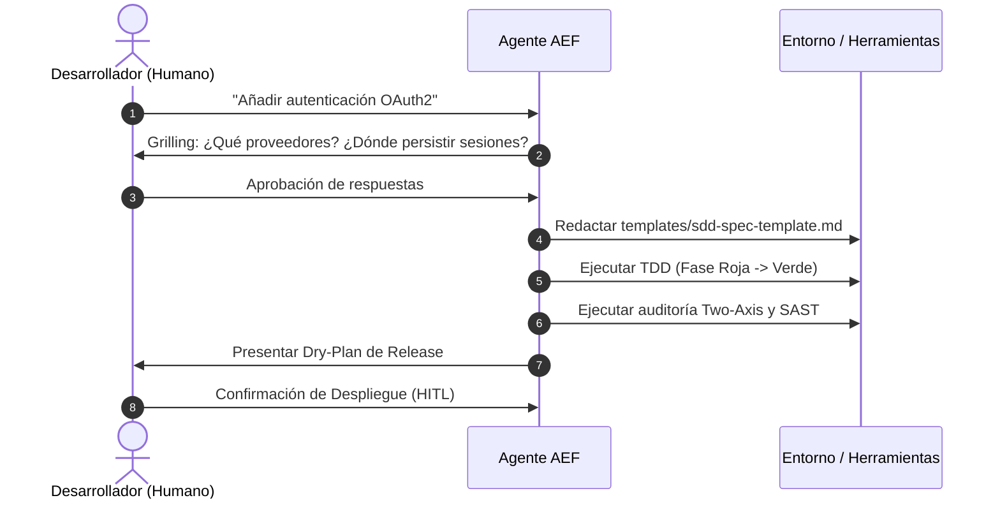

# Agentic Engineering Framework (AEF)

<div align="center">


<p align="center">
  <b>Un marco de ingeniería determinista para gobernar, orquestar y operar equipos de agentes de IA autónomos con Human-in-the-Loop (HITL).</b>
</p>

[Metodología](docs/METHODOLOGY.md) • [Roles de Agentes](docs/ROLES.md) • [Glosario](docs/GLOSSARY.md) • [Reglas](rules/AGENTS.md) • [Plantillas](templates/) • [Skills](skills/)

</div>

---

## 🎯 ¿Por qué este Framework?

El uso improvisado de IA generativa en el desarrollo de software (*"vibe coding"*) genera:
1. **Código no determinista y sin justificación arquitectónica**: Alucinaciones y asunciones falsas en modelos de datos.
2. **Deuda técnica acelerada**: Código que "parece funcionar" pero carece de pruebas empíricas contra la realidad (*Ground Truth*).
3. **Brechas de seguridad y permisos excesivos**: Agentes con acceso destructivo sin políticas de mínimo privilegio (*PoLP*) ni controles de calidad.

**Agentic Engineering Framework (AEF)** transforma a los agentes de IA de simples generadores de texto en **equipos de ingeniería especializados y gobernados**, donde cada agente opera bajo un rol acotado y el humano mantiene el control estratégico de decisión (*Human-in-the-Loop*).

---

## 🏛️ Ciclo de Vida Determinista (6 Fases Inmutables)



Para consultar el desglose exhaustivo de inputs, outputs y quality gates, consulta [`docs/METHODOLOGY.md`](docs/METHODOLOGY.md).

---

## 👥 Especialización de Roles de Subagentes

Para prevenir la contaminación de contexto y el sobreprivilegio operativo, AEF define 5 subagentes con límites de ejecución basados en el Principio de Mínimo Privilegio (PoLP):



| Rol del Agente | Responsabilidad Principal | Herramientas & Límites |
| :--- | :--- | :--- |
| **System Architect** | Diseño de arquitectura, ADRs, contratos tipados y topología visual. | Sin ejecución destructiva. Read-only + docs. |
| **TDD Implementer** | Desarrollo estricto de componentes y lógica cubiertos por pruebas. | Tests unitarios y código mínimo para pasar. |
| **QA Automation Lead** | Verificación empírica de compilación, linter y accesibilidad. | Ejecución de linter, build y suites de test. |
| **Security Auditor** | Auditoría estricta OWASP Top 10, permisos mínimos, SAST y Docker hardening. | Escaneo estático y análisis de dependencias. |
| **Release Architect** | Planificación de despliegues, estrategias de rollback y health checks. | **Zero-execution dry plans** hasta confirmación humana. |

Consulta [`docs/ROLES.md`](docs/ROLES.md) para conocer las fichas de responsabilidades y herramientas permitidas.

---

## 🚀 Modos de Uso y Adopción

AEF está diseñado para adoptarse de manera flexible según la escala de tu equipo y herramientas:

### Modo 1: En tu Asistente de IA (Antigravity / Cursor / Claude Code)
Copia la carpeta de reglas y skills al directorio de configuración de tu asistente preferido:
- **Reglas del Proyecto**: Coloca [`rules/AGENTS.md`](rules/AGENTS.md) como `.agents/rules/AGENTS.md` o en las instrucciones del sistema.
- **Skills Ejecutables**: Añade las carpetas de [`skills/`](skills/) en tu directorio de skills (ej. `.agents/skills/`).

### Modo 2: En la Creación de un Nuevo Proyecto
Utiliza las plantillas en [`templates/`](templates/) para inicializar la documentación viva:
```bash
# 1. Copiar plantillas al nuevo proyecto
cp -r templates/ mi-nuevo-proyecto/templates/
cp docs/GLOSSARY.md mi-nuevo-proyecto/docs/
```

### Modo 3: En el Flujo de Trabajo Diario


---

## 📂 Estructura del Framework

```text
agentic-engineering-framework/
├── README.md               # Este manifiesto y guía visual
├── CHANGELOG.md            # Historial de versiones y releases
├── LICENSE                 # Licencia MIT
├── docs/                   # Guías metodológicas y estándares
│   ├── METHODOLOGY.md      # Protocolo detallado de las 6 fases inmutables
│   ├── ROLES.md            # Catálogo de agentes y matriz de permisos
│   └── GLOSSARY.md         # Vocabulario de dominio de ingeniería agéntica
├── rules/                  # Reglas del sistema y principios Karpathy x Pocock
│   └── AGENTS.md           # Directrices universales para asistentes de IA
├── skills/                 # Procedimientos ejecutables
│   ├── align-and-plan/     # Alineación previa y preguntas interactivas
│   ├── diagnose-bug/       # Diagnóstico determinista (Repro-First)
│   ├── code-review/        # Revisión de código en dos ejes
│   ├── tdd-verify/         # Ciclo de desarrollo guiado por pruebas
│   └── version-bump/       # Incremento SemVer y sincronización de release
└── templates/              # Plantillas canónicas
    ├── adr-template.md         # Plantilla de decisiones arquitectónicas
    ├── sdd-spec-template.md    # Plantilla de especificación técnica
    ├── atomic-plan-template.md # Plantilla de tareas atómicas
    └── release-plan-template.md# Plantilla de plan de release y rollback
```

---

## 📄 Licencia

Este proyecto está bajo licencia **MIT**. Diseñado y mantenido por [Jose Miguel Blanco](https://github.com/jmblanco).
