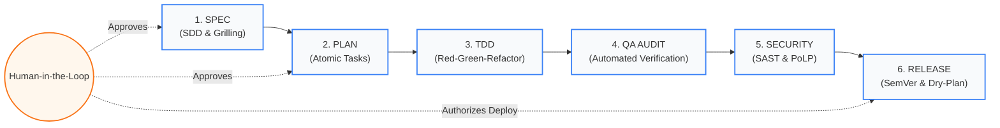
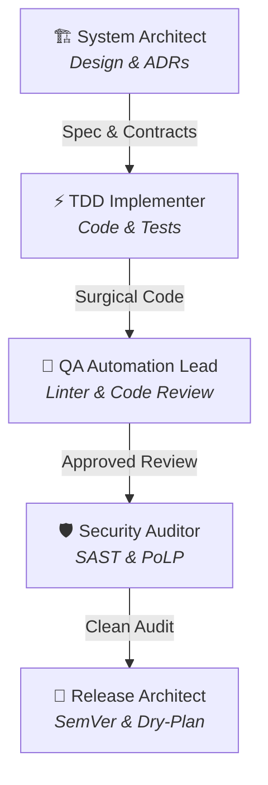
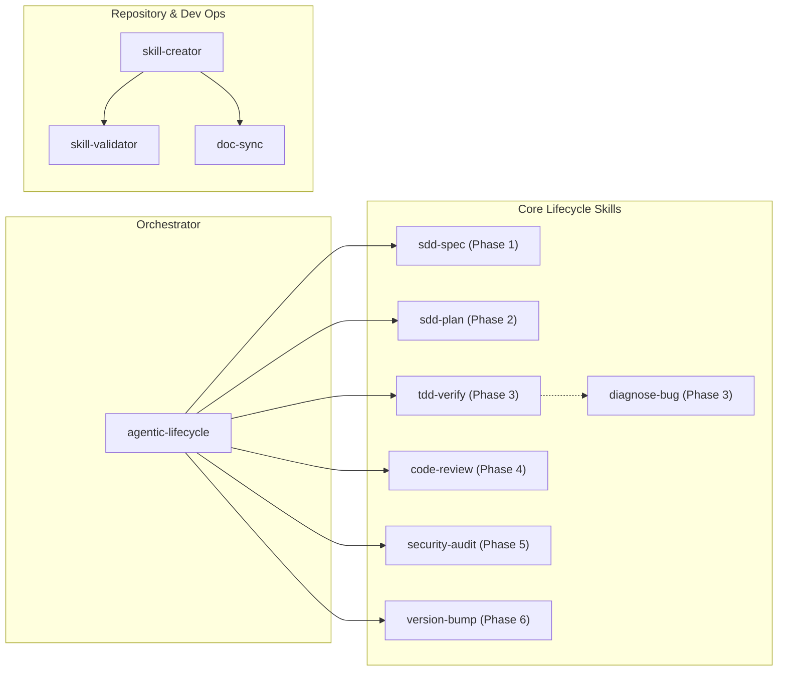
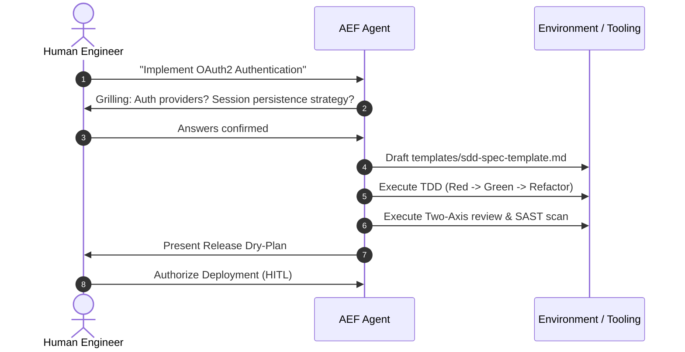

# Agentic Engineering Framework (AEF)

<div align="center">


<p align="center">
  <b>A lean, deterministic engineering framework to govern, orchestrate, and operate autonomous AI agent teams with Human-in-the-Loop (HITL).</b>
</p>

[Methodology](docs/METHODOLOGY.md) • [Agent Roles](docs/ROLES.md) • [Glossary](docs/GLOSSARY.md) • [Rules](rules/AGENTS.md) • [Templates](templates/) • [Skills](skills/)

</div>

---

## 🎯 Why This Framework?

Unstructured generative AI software development (*"vibe coding"*) introduces critical systemic risks:
1. **Non-deterministic code with speculative architecture**: Hallucinations and invalid assumptions across domain models.
2. **Accelerated technical debt**: Code that "appears to work" but lacks empirical ground-truth verification against reality.
3. **Security vulnerabilities and over-privileged execution**: Agents operating with unrestricted write/execution access without quality gates or least privilege policies.

**Agentic Engineering Framework (AEF)** transitions AI agents from naive autocomplete tools into **specialized, governed engineering teams**, where each agent operates within strict execution boundaries while human engineers retain strategic control (*Human-in-the-Loop*).

---

## 🏛️ Deterministic Lifecycle (6 Immutable Phases)



For full details on inputs, outputs, and quality gates for every phase, refer to [`docs/METHODOLOGY.md`](docs/METHODOLOGY.md) and execute via [`skills/agentic-lifecycle`](skills/agentic-lifecycle/SKILL.md).

---

## 👥 Specialized Subagent Roles

To prevent context contamination and over-privileged operations, AEF defines 5 dedicated subagents governed by the Principle of Least Privilege (PoLP):



| Agent Role | Primary Responsibility | Primary Skills | Tools & Boundaries |
| :--- | :--- | :--- | :--- |
| **System Architect** | Architecture, ADRs, strict data contracts, and visual topology. | `sdd-spec`, `sdd-plan` | Read-only on code + docs. No destructive commands. |
| **TDD Implementer** | Test-driven implementation of logic and components. | `tdd-verify`, `diagnose-bug` | Local unit/integration tests and minimal surgical code. |
| **QA Automation Lead** | Empirical build, linter, strict typing, and independent auditing. | `code-review` | Execution of linters, compiler, and test suites. |
| **Security Auditor** | OWASP Top 10 auditing, PoLP enforcement, SAST, and container hardening. | `security-audit` | Static analysis, dependency scanners (SCA), and secret recon. |
| **Release Architect** | Release orchestration, SemVer versioning, rollback strategy, and changelogs. | `version-bump` | **Zero-execution dry plans** until explicit human authorization. |

Refer to [`docs/ROLES.md`](docs/ROLES.md) for complete role profiles and tool permissions.

---

## 🧰 Lean Skills Catalogue

AEF provides a lean, focused collection of executable runbooks organized into the Core Lifecycle and Repository Tooling:



---

## 🚀 Adoption and Usage Modes

AEF is designed for modular adoption across diverse development environments:

### Mode 1: Within AI Coding Assistants (Antigravity / Cursor / Claude Code)
Embed rules and skills directly into your assistant's configuration directory:
- **Project Rules**: Place [`rules/AGENTS.md`](rules/AGENTS.md) as `.agents/rules/AGENTS.md` or append to your system prompt.
- **Agent Directives**: Keep [`.agents/AGENTS.md`](.agents/AGENTS.md) and [`.gemini/GEMINI.md`](.gemini/GEMINI.md) for assistant-specific execution guidelines.
- **Executable Skills**: Copy folders from [`skills/`](skills/) into your skills directory (e.g. `.agents/skills/`).

### Mode 2: Automated Skill Validation
Verify the health and compliance of all skills in your project using the deterministic validation suite:
```bash
npm run validate
# Or directly:
node scripts/validate-skills.mjs
```

### Mode 3: Daily Engineering Workflow


---

## 📂 Framework Structure

```text
agentic-engineering-framework/
├── README.md               # Framework overview and visual guide
├── CHANGELOG.md            # Version history following Keep a Changelog
├── LICENSE                 # MIT License
├── package.json            # Tooling and validation scripts
├── .agents/
│   └── AGENTS.md           # Instructions for AI agents operating on AEF itself
├── .gemini/
│   └── GEMINI.md           # Workspace instructions for Gemini / Antigravity
├── docs/                   # Methodological guides and standards
│   ├── METHODOLOGY.md      # Detailed 6-phase deterministic lifecycle
│   ├── ROLES.md            # Agent catalogue and privilege matrix
│   └── GLOSSARY.md         # Ubiquitous domain language for agentic engineering
├── rules/                  # Core governance and Karpathy x Pocock principles
│   └── AGENTS.md           # Universal instructions for AI agents
├── scripts/                # Automated audit and validation scripts
│   └── validate-skills.mjs # Cross-platform Node.js skill auditor
├── skills/                 # Lean executable runbooks
│   ├── agentic-lifecycle/  # Master 6-phase orchestrator
│   ├── sdd-spec/           # Spec authoring & interactive grilling (Phase 1)
│   ├── sdd-plan/           # Atomic task planning & verification commands (Phase 2)
│   ├── tdd-verify/         # TDD Red-Green-Refactor (Phase 3)
│   ├── diagnose-bug/       # Deterministic bug diagnosis (Phase 3 troubleshooting)
│   ├── code-review/        # Independent two-axis code review (Phase 4)
│   ├── security-audit/     # SAST, SCA, and PoLP security audit (Phase 5)
│   ├── version-bump/       # SemVer release & Dry-Plan (Phase 6)
│   ├── skill-creator/      # Onboarding guide for new agent skills
│   ├── skill-validator/    # Quality and safety validator for skills
│   └── doc-sync/           # Automated repository documentation synchronizer
└── templates/              # Canonical documentation templates
    ├── adr-template.md         # Architectural Decision Record template
    ├── sdd-spec-template.md    # Technical specification template
    ├── atomic-plan-template.md # Atomic task plan template
    └── release-plan-template.md# Release plan and rollback template
```

---

## 📄 License

This project is licensed under the **MIT License**. Designed and maintained by [Jose Miguel Blanco](https://github.com/jmblanco).
