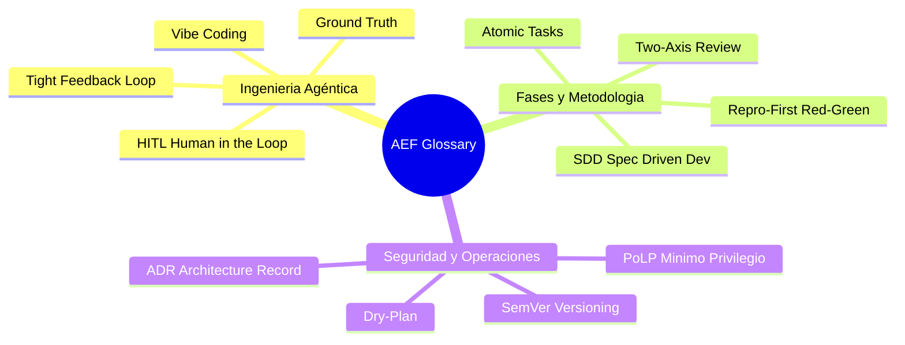

# GLOSSARY.md — Vocabulario Ubicuo de AEF

Este glosario define los términos de dominio del **Agentic Engineering Framework (AEF)**. Garantiza que desarrolladores humanos y agentes de inteligencia artificial compartan exactamente el mismo modelo mental sin ambigüedad terminológica.

---

---

### Términos de Dominio

| Término | Definición | Contexto / Ubicación |
| :--- | :--- | :--- |
| **Human-in-the-Loop (HITL)** | Principio de gobernanza donde las decisiones críticas de diseño, cambios de especificación y mutaciones destructivas en producción requieren aprobación humana explícita. | Gobernanza y Filosofía |
| **Ground Truth** | Verificación empírica e irrefutable contra el entorno de ejecución real (pruebas pasando, compilación limpia, respuestas HTTP) frente a la asunción mental o código especulativo. | Principio Karpathy |
| **Vibe Coding** | Práctica no estructurada de generar bloques de código con IA basándose en corazonadas o pruebas superficiales sin justificación arquitectónica ni tests deterministas. | Anti-patrón mitigado por AEF |
| **Tight Feedback Loop** | Ciclo de retroalimentación ultrarrápido donde el agente valida cada pequeño cambio en segundos mediante un comando de fallo/éxito determinista. | `skills/diagnose-bug` |
| **Spec-Driven Development (SDD)** | Enfoque de ingeniería donde ninguna línea de código se escribe sin una especificación técnica previa cerrada, validada y con criterios de aceptación explícitos. | Fase 1 del ciclo de vida |
| **Grilling** | Proceso iterativo de preguntas estructuradas donde el agente interroga activamente al humano para desambiguar requerimientos antes de planificar. | `skills/align-and-plan` |
| **Atomic Task** | Unidad mínima de trabajo de ingeniería independiente, que modifica un alcance acotado y cuenta con un comando de validación individualizado. | Fase 2 del ciclo de vida |
| **Repro-First (Fase Roja)** | Regla inquebrantable de diagnóstico que exige reproducir un fallo mediante un test o script determinista antes de modificar código fuente. | `skills/diagnose-bug` |
| **Two-Axis Review** | Auditoría de código que evalúa simultáneamente dos dimensiones independientes: 1) Conformidad con la especificación y 2) Detección de *Code Smells* y calidad técnica. | `skills/code-review` |
| **Principle of Least Privilege (PoLP)** | Restricción estricta de permisos para que cada agente opere únicamente con las herramientas y capacidades indispensables para su rol. | Fase 5 de Seguridad |
| **Dry-Plan** | Simulación detallada previa a una ejecución de release o despliegue, mostrando exactamente qué cambiará y cuál es el procedimiento de rollback sin alterar el entorno. | Fase 6 de Release |
| **Architecture Decision Record (ADR)** | Documento corto y versionado que captura una decisión técnica relevante, su justificación, alternativas evaluadas y compensaciones (*trade-offs*). | `templates/adr-template.md` |
