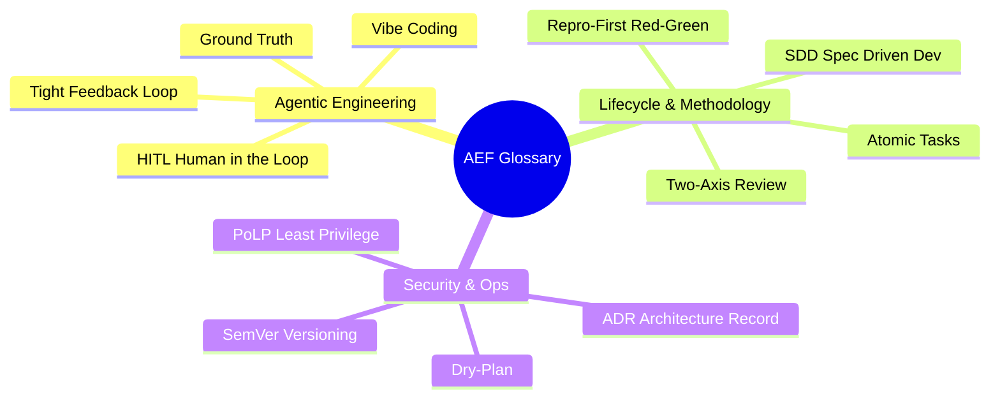

# GLOSSARY.md — Ubiquitous Language for AEF

This glossary defines domain concepts for the **Agentic Engineering Framework (AEF)**. It ensures human engineers and autonomous AI agents share the exact same mental model without semantic drift or ambiguity.

---

---

### Domain Terms

| Term | Definition | Context / Reference |
| :--- | :--- | :--- |
| **Human-in-the-Loop (HITL)** | Governance model requiring explicit human authorization for high-stakes decisions, architectural changes, and production mutations. | Governance & Philosophy |
| **Ground Truth** | Irrefutable empirical verification against the real execution environment (passing test suites, clean compilation, valid HTTP payloads) as opposed to theoretical assumptions. | Karpathy Principle |
| **Vibe Coding** | Anti-pattern of writing software by relying on generative AI prompts without deterministic tests, architectural justification, or verification loops. | Mitigated by AEF |
| **Tight Feedback Loop** | Ultra-fast execution cycle where an agent verifies each modification within seconds using a deterministic pass/fail command. | `skills/diagnose-bug` |
| **Spec-Driven Development (SDD)** | Engineering discipline ensuring no production code is written prior to an approved, unambiguous technical specification with explicit acceptance criteria. | Phase 1 of Lifecycle |
| **Grilling** | Structured interactive interrogation process where an AI agent prompts the human engineer to eliminate ambiguities before drafting plans. | `skills/align-and-plan` |
| **Atomic Task** | Self-contained, isolated unit of work addressing a focused scope and paired with an empirical verification command. | Phase 2 of Lifecycle |
| **Repro-First (Red Phase)** | Non-negotiable debugging rule requiring reproducible proof of failure via a script or test before altering production code. | `skills/diagnose-bug` |
| **Two-Axis Review** | Code review auditing two independent dimensions: 1) Specification compliance and 2) Code quality & anti-pattern detection. | `skills/code-review` |
| **Principle of Least Privilege (PoLP)** | Security standard restricting agent access exclusively to tools and permissions required for its designated role. | Phase 5 Security Audit |
| **Dry-Plan** | Transparent pre-execution simulation detailing exact operations and rollback plans before running mutating or release commands. | Phase 6 Release Planning |
| **Architecture Decision Record (ADR)** | Short, versioned document capturing an important architectural decision, its rationale, evaluated alternatives, and associated trade-offs. | `templates/adr-template.md` |
