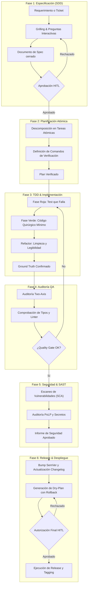

# Metodología AEF: Ciclo de Vida Determinista en 6 Fases

El **Agentic Engineering Framework (AEF)** establece un estándar riguroso para la entrega de software asistida por agentes autónomos. Cada fase cuenta con entradas claras, artefactos de salida verificables y puertas de calidad (*quality gates*).

---

## 🗺️ Mapa de Flujo del Ciclo de Vida

---

## 📌 Detalle de las 6 Fases

### Fase 1: Especificación Técnica (SDD - Spec-Driven Development)
* **Objetivo**: Erradicar asunciones antes de escribir código.
* **Proceso**:
  1. El agente analiza el requerimiento e identifica lagunas en requerimientos de datos, UX, rendimiento o límites.
  2. Ejecuta un proceso de **Grilling** mediante preguntas concisas con opciones predeterminadas recomendadas.
  3. Redacta la especificación usando la plantilla [`templates/sdd-spec-template.md`](../templates/sdd-spec-template.md).
* **Quality Gate (HITL)**: El usuario humano aprueba formalmente la especificación.

### Fase 2: Planificación Atómica
* **Objetivo**: Fragmentar la especificación en incrementos verificables de forma independiente.
* **Proceso**:
  1. Cada tarea debe poder resolverse en una intervención acotada.
  2. Cada tarea define obligatoriamente su **comando de verificación empírico** (ej. test suite, compilación TypeScript, script de comprobación).
* **Artefacto**: [`templates/atomic-plan-template.md`](../templates/atomic-plan-template.md).

### Fase 3: TDD & Implementación (Red-Green-Refactor)
* **Objetivo**: Garantizar fidelidad al comportamiento esperado mediante verificación contra la realidad (*Ground Truth*).
* **Proceso**:
  - 🔴 **Rojo**: Escribir la prueba unitaria o de integración y validar que falle por el motivo exacto esperado.
  - 🟢 **Verde**: Escribir la implementación mínima necesaria para pasar la prueba.
  - 🔵 **Refactor**: Optimizar legibilidad, modularidad y rendimiento manteniendo la suite en verde.

### Fase 4: Auditoría QA Independiente
* **Objetivo**: Asegurar que la implementación no introduce deuda técnica, regresiones ni roturas de tipos.
* **Proceso**:
  - Evaluación en dos ejes según [`skills/code-review`](../skills/code-review/SKILL.md):
    - **Eje 1**: Cumplimiento de la especificación original.
    - **Eje 2**: Detección de *Code Smells*, tipado estricto y accesibilidad.
* **Quality Gate**: Cero errores de tipado, linter y tests pasando al 100%.

### Fase 5: Auditoría de Seguridad & SAST (Raptor / Security)
* **Objetivo**: Prevenir vulnerabilidades (OWASP Top 10), exposición de secretos y excesos de permisos.
* **Proceso**:
  - Verificación de dependencias y análisis estático de seguridad (SAST).
  - Aplicación estricta del **Principio de Mínimo Privilegio (PoLP)** en configuración, IAM o variables de entorno.
  - Comprobación de que no existan credenciales en texto plano.

### Fase 6: Release & Despliegue Dry-Plan
* **Objetivo**: Ejecución controlada, determinista y reversible del empaquetado y puesta en producción.
* **Proceso**:
  1. Cálculo de incremento SemVer (Major, Minor, Patch).
  2. Sincronización de `CHANGELOG.md` siguiendo el estándar *Keep a Changelog*.
  3. Redacción obligatoria de un **Dry-Plan** que detalle los pasos exactos y el plan de rollback en caso de fallo.
* **Quality Gate (HITL)**: El humano autoriza expresamente la ejecución del despliegue y creación del tag.
