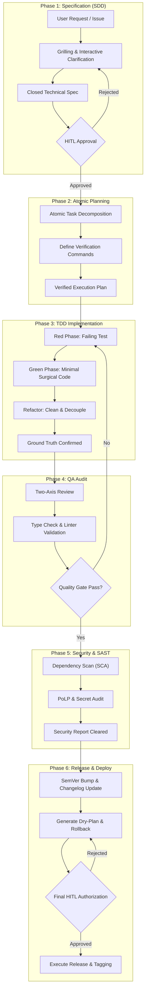

# AEF Methodology: The 6-Phase Deterministic Lifecycle

The **Agentic Engineering Framework (AEF)** establishes a disciplined execution methodology for software delivery with autonomous agent teams. Each phase enforces explicit inputs, verifiable output artifacts, and strict quality gates.

---

## 🗺️ Lifecycle Flow Diagram

---

## 📌 Phase-by-Phase Execution

### Phase 1: Technical Specification (SDD - Spec-Driven Development)
* **Objective**: Eliminate assumptions prior to code authoring.
* **Process**:
  1. The agent analyzes the user prompt and isolates ambiguities in data contracts, edge cases, UX, or dependencies.
  2. Executes **Grilling** via concise multiple-choice questions with explicit recommended defaults.
  3. Authors an unambiguous technical specification using [`templates/sdd-spec-template.md`](../templates/sdd-spec-template.md).
* **Quality Gate (HITL)**: The human engineer explicitly signs off on the specification.

### Phase 2: Atomic Task Planning
* **Objective**: Deconstruct the specification into isolated, verifiable increments.
* **Process**:
  1. Each task must be scoped to an atomic intervention.
  2. Every task must declare its **empirical verification command** (e.g. test runner invocation, TypeScript type-check, or test script).
* **Artifact**: [`templates/atomic-plan-template.md`](../templates/atomic-plan-template.md).

### Phase 3: Test-Driven Development (Red-Green-Refactor)
* **Objective**: Ensure software correctness through empirical verification against the real runtime (*Ground Truth*).
* **Process**:
  - 🔴 **Red**: Write a failing unit or integration test reproducing the target behavior. Verify that it fails for the expected reason.
  - 🟢 **Green**: Write the minimal surgical code required to turn the test green.
  - 🔵 **Refactor**: Improve readability and modularity while maintaining all tests green.

### Phase 4: Independent QA Audit
* **Objective**: Guard against technical debt, regression, and code smells.
* **Process**:
  - Perform Two-Axis review following [`skills/code-review`](../skills/code-review/SKILL.md):
    - **Axis 1**: Specification compliance.
    - **Axis 2**: Code smell detection, strict typing, and accessibility.
* **Quality Gate**: Zero type-checker warnings, zero linter errors, and 100% test pass rate.

### Phase 5: Security & SAST Audit (Raptor / Security)
* **Objective**: Fortify the repository against OWASP Top 10 vulnerabilities, leaked secrets, and privilege escalation.
* **Process**:
  - Software Composition Analysis (SCA) on external dependencies.
  - Enforce the **Principle of Least Privilege (PoLP)** across configurations and IAM roles.
  - Scan for plaintext credentials, tokens, and non-hardened infrastructure templates.

### Phase 6: Release & Dry-Plan Deployment
* **Objective**: Controlled, deterministic, and reversible release execution.
* **Process**:
  1. Determine SemVer bump (Major, Minor, Patch).
  2. Synchronize `CHANGELOG.md` following the *Keep a Changelog* standard.
  3. Draft an explicit **Dry-Plan** with an immediate rollback procedure.
* **Quality Gate (HITL)**: The human engineer authorizes execution before tags or deployments are initiated.
