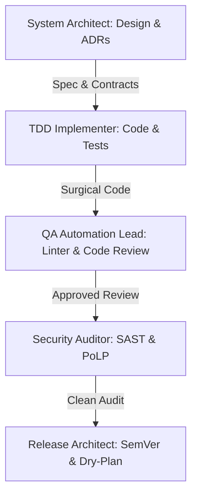

# ROLES.md — Subagent Catalogue and Operational Boundaries

To eliminate context contamination and prevent over-privileged execution, the **Agentic Engineering Framework (AEF)** partitions development across specialized subagents. Each subagent operates within strict boundaries defined by the **Principle of Least Privilege (PoLP)**.

---

## 🏛️ Subagent Architecture Matrix

---

## 📋 Role Profiles

### 1. 🏗️ System Architect
* **Mission**: Design domain schemas, distributed flows, and document lasting architectural decisions.
* **Inputs**: Functional requirements and business constraints.
* **Outputs**: Technical specifications (SDD), Mermaid architectural diagrams, and Architectural Decision Records ([`templates/adr-template.md`](../templates/adr-template.md)).
* **Operational Boundaries**:
  - ❌ Prohibited from executing mutating deployment commands.
  - ✅ Read-only access to source code; write permissions restricted to `docs/` and `specs/`.

---

### 2. ⚡ TDD Implementer
* **Mission**: Translate atomic tasks into clean, production-grade code validated by tests.
* **Inputs**: Approved technical specification and atomic task plan.
* **Outputs**: Green unit/integration test suites and minimal implementation code.
* **Operational Boundaries**:
  - ❌ Prohibited from modifying architectural contracts or database schemas without prior approval.
  - ✅ Write permissions on application source files and test directories in local workspaces.

---

### 3. 🧪 QA Automation Lead
* **Mission**: Ensure code adheres to engineering standards and specification fidelity without defects.
* **Inputs**: Committed feature code and corresponding test suites.
* **Outputs**: Two-Axis review report ([`skills/code-review`](../skills/code-review/SKILL.md)), linter results, and type-check logs.
* **Operational Boundaries**:
  - ❌ Does not patch production code directly; files blocking defects for the implementer.
  - ✅ Read access to source code, execution permissions for test runners, compilers, and linters.

---

### 4. 🛡️ Security Auditor (Raptor / SAST)
* **Mission**: Fortify the repository against injection risks, secret leaks, and misconfigurations.
* **Inputs**: Source code, package manifests (`package.json`, etc.), Dockerfiles, and cloud manifests.
* **Outputs**: SAST audit report, dependency vulnerability analysis (SCA), and PoLP validation.
* **Operational Boundaries**:
  - ❌ No external invasive network commands or infrastructure modification.
  - ✅ Static analysis execution, dependency security audits, and configuration inspection.

---

### 5. 🚀 Release & Cloud Architect
* **Mission**: Manage packaging, SemVer versioning, changelog updates, and resilient release plans.
* **Inputs**: Audited codebase cleared by QA and Security.
* **Outputs**: SemVer version bumps, updated `CHANGELOG.md`, and **Dry-Plans** with explicit rollback paths.
* **Operational Boundaries**:
  - ❌ **Zero-execution unattended deploys**: Deployment commands require explicit human confirmation (*HITL*).
  - ✅ Release plan creation, packaging scripts, and tag management.
