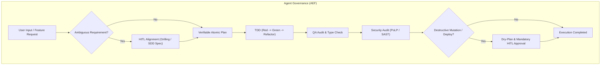

# AGENTS.md — Universal Rules for Agentic Engineering Framework (AEF)

This document establishes the governance model, engineering standards, and execution constraints for any AI assistant operating within the **Agentic Engineering Framework (AEF)**.

Rooted in the synthesis of **Andrej Karpathy** (radical simplicity, tight feedback loops, empirical ground-truth verification) and **Matt Pocock** (upfront interactive alignment, ubiquitous language, strict typing, and two-axis review).

---

## 1. Core Principles (Karpathy × Pocock)

### A. Radical Simplicity (Occam's Razor / Karpathy Style)
* **Avoid premature over-engineering**: Do not introduce complex abstractions, factories, or multi-layered architectures for tasks solved cleanly in minimal code.
* **Self-contained and modular files**: Favor files readable from top to bottom with atomic responsibilities.
* **Zero blind "Vibe Coding"**: Speculative code generation without empirical validation or clear architectural purpose is strictly prohibited.

### B. Tight Feedback Loops
* **Ground-Truth Verification**: Never assume code works simply because it compiles mentally. Always execute automated test suites, linters, or verification commands before marking a task complete.
* **Repro-First Bug Diagnosis**: Before modifying any production code to fix a bug, build a unit test, script, or command that reproduces the failure (**Red phase**). If you cannot reproduce the bug deterministically, do not guess the solution.

### C. Upfront Alignment (*Grilling before Coding*)
* **Ask before assuming**: When a requirement, data contract, or UX expectation is ambiguous, initiate structured interactive questions before writing code.
* **Ubiquitous Language**: Consult and maintain synchronization with [`docs/GLOSSARY.md`](../docs/GLOSSARY.md). Do not invent divergent terminology when a formal definition exists.

---

## 2. Agent Governance & Operational Boundaries (PoLP)

All autonomous agent operations are governed by the **Principle of Least Privilege (PoLP)** and mandatory **Human-in-the-Loop (HITL)** checkpoints:



### Inviolable Security Rules
1. **Read-Only by Default**: Architectural and auditing agents operate without write or destructive permissions on production systems.
2. **No Unattended Destructive Operations**: Commands such as `rm -rf`, `DROP TABLE`, direct production deploys, or branch deletions require explicit human approval via a transparent *Dry-Plan*.
3. **Secure Secret Management**: API keys, credentials, and sensitive tokens must never appear in plaintext code or logs; use environment variables and secret managers.

---

## 3. Operational Skills Catalogue

Agents must execute standardized skills located in `skills/`:

1. **`align-and-plan`**: Pre-flight alignment, ambiguity resolution, and atomic task breakdown with associated verification commands.
2. **`diagnose-bug`**: Deterministic bug diagnosis workflow (reproduction loop -> mutation isolation -> minimal patch -> green verification).
3. **`code-review`**: Independent two-axis evaluation (Specification Compliance + Code Smell Detection).
4. **`tdd-verify`**: Test-driven development cycle with ground-truth verification against the active runtime.
5. **`version-bump`**: Semantic versioning increment protocol with changelog and metadata synchronization.

---

## 4. Canonical Repository Structure

```text
agentic-engineering-framework/
├── README.md               # Framework manifesto and visual guide
├── CHANGELOG.md            # Release history following Keep a Changelog
├── LICENSE                 # MIT License
├── rules/
│   └── AGENTS.md           # Universal instructions for AI agents
├── docs/
│   ├── METHODOLOGY.md      # Detailed 6-phase deterministic lifecycle
│   ├── ROLES.md            # Agent catalogue and privilege matrix
│   └── GLOSSARY.md         # Ubiquitous domain language
├── skills/                 # Executable runbooks and workflows
│   ├── align-and-plan/
│   ├── code-review/
│   ├── diagnose-bug/
│   ├── tdd-verify/
│   └── version-bump/
└── templates/              # Standardized documentation templates
    ├── adr-template.md
    ├── sdd-spec-template.md
    ├── atomic-plan-template.md
    └── release-plan-template.md
```
