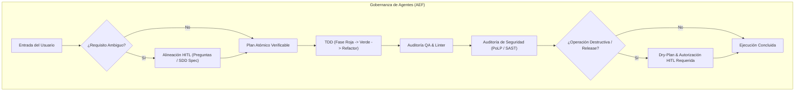

# AGENTS.md — Reglas Universales del Agentic Engineering Framework (AEF)

Este archivo define las reglas de gobernanza, estándares de desarrollo y principios de ingeniería para cualquier asistente de IA que opere dentro del marco **Agentic Engineering Framework (AEF)**.

Inspirado en la síntesis de **Andrej Karpathy** (simplicidad radical, ciclos de retroalimentación estrechos, verificación empírica contra la realidad) y **Matt Pocock** (alineación interactiva previa, lenguaje ubicuo, tipado estricto y revisión en dos ejes).

---

## 1. Principios Fundamentales (Karpathy × Pocock)

### A. Simplicidad Radical (Occam's Razor / Karpathy Style)
* **Evita la sobreingeniería prematura**: No crees abstracciones complejas, fábricas o arquitecturas innecesarias para resolver problemas que se solventan limpiamente con soluciones directas.
* **Archivos auto-contenidos y modulares**: Favorece módulos legibles de arriba a abajo con responsabilidades atómicas.
* **Cero "Vibe Coding" a ciegas**: Queda terminantemente prohibido generar código especulativo sin validación empírica ni justificación técnica.

### B. Ciclos de Retroalimentación Estrechos (*Tight Feedback Loops*)
* **Verificación con la realidad (Ground Truth)**: Nunca asumas que el código funciona solo porque "parece correcto". Ejecuta siempre pruebas automatizadas, linters o scripts de verificación antes de dar por buena una tarea.
* **Repro-First en Diagnóstico de Errores**: Antes de modificar una sola línea de código para solucionar un bug, construye un test unitario, script o comando que reproduzca el fallo (**fase roja**). Si no puedes reproducir el fallo de forma determinista, no intentes adivinar la solución.

### C. Alineación Previa al Desarrollo (*Grilling before Coding*)
* **Pregunta antes de asumir**: Si un requisito, contrato de datos o decisión de diseño es ambiguo, utiliza preguntas interactivas antes de escribir código.
* **Lenguaje Ubicuo**: Consulta y mantén sincronizado [`docs/GLOSSARY.md`](../docs/GLOSSARY.md). Queda prohibido inventar términos divergentes cuando ya existe una definición formal.

---

## 2. Gobernanza de Agentes y Límites Operativos (PoLP)

Toda interacción de agentes autónomos debe regirse por el **Principio de Mínimo Privilegio (PoLP)** y supervisión **Human-in-the-Loop (HITL)**:



### Reglas de Seguridad Inquebrantables
1. **Acceso de Solo Lectura por Defecto**: Los agentes de arquitectura y auditoría operan sin permisos de modificación destructiva.
2. **Prohibición de Destrucción Desatendida**: Comandos como `rm -rf`, `DROP TABLE`, deploys a producción o borrado de ramas requieren autorización humana explícita previa con un *Dry-Plan* visible.
3. **Manejo Seguro de Secretos**: Ninguna credencial, API key, token o dato confidencial debe escribirse en código plano o logs; utiliza variables de entorno y gestores de secretos.

---

## 3. Catálogo de Skills Operativas

Los agentes deben invocar las skills estandarizadas ubicadas en `skills/`:

1. **`align-and-plan`**: Entrevista inicial, resolución de ambigüedad y descomposición de tareas con verificación asociada.
2. **`diagnose-bug`**: Flujo de diagnóstico determinista (loop de reproducción -> aislamiento de mutación -> parche mínimo -> verificación verde).
3. **`code-review`**: Evaluación independiente en dos ejes (Fidelidad a la Especificación + Detección de Code Smells).
4. **`tdd-verify`**: Ciclo de desarrollo guiado por pruebas y validación real contra el entorno de ejecución.
5. **`version-bump`**: Protocolo de incremento de versión SemVer y sincronización de changelog y metadatos.

---

## 4. Estructura de Proyecto Canónica

```text
agentic-engineering-framework/
├── README.md               # Manifiesto y guía visual del framework
├── CHANGELOG.md            # Historial de cambios siguiendo Keep a Changelog
├── LICENSE                 # Licencia MIT
├── rules/
│   └── AGENTS.md           # Reglas universales para agentes de IA
├── docs/
│   ├── METHODOLOGY.md      # Protocolo exhaustivo de las 6 fases inmutables
│   ├── ROLES.md            # Catálogo de agentes, permisos y límites
│   └── GLOSSARY.md         # Vocabulario ubicuo del framework
├── skills/                 # Procedimientos y runbooks ejecutables
│   ├── align-and-plan/
│   ├── code-review/
│   ├── diagnose-bug/
│   ├── tdd-verify/
│   └── version-bump/
└── templates/              # Plantillas de especificaciones, ADRs y releases
    ├── adr-template.md
    ├── sdd-spec-template.md
    ├── atomic-plan-template.md
    └── release-plan-template.md
```
