# Agentic Lifecycle Orchestrator (AEF)

This skill provides the overarching end-to-end execution workflow for autonomous multi-agent software engineering within the **Agentic Engineering Framework (AEF)**. It deterministically coordinates subagents across the 6 lifecycle phases while enforcing strict **Principle of Least Privilege (PoLP)** and **Human-in-the-Loop (HITL)** governance.

---

## 🗺️ Execution Pipeline

```mermaid
flowchart TD
    subgraph P1["Phase 1: Spec & Architecture"]
        A1["User Prompt / Feature Request"] --> A2["Grilling & Ambiguity Resolution"]
        A2 --> A3["Closed Spec & ADRs"]
        A3 --> G1{"HITL Gate 1: Approve Spec"}
    end

    subgraph P2["Phase 2: Atomic Planning"]
        G1 -- Approved --> B1["Atomic Task Decomposition"]
        B1 --> B2["Pair Verification Commands"]
        B2 --> G2{"HITL Gate 2: Approve Plan"}
    end

    subgraph P3["Phase 3: TDD Implementation"]
        G2 -- Approved --> C1["Red: Failing Test Suite"]
        C1 --> C2["Green: Minimal Surgical Code"]
        C2 --> C3["Refactor: Clean & Decouple"]
        C3 --> C4["Ground-Truth Verification"]
    end

    subgraph P4["Phase 4: Independent QA"]
        C4 --> D1["Two-Axis Review (Spec + Smells)"]
        D1 --> D2["Strict Type Check & Linter"]
        D2 --> D3{"QA Quality Gate"}
    end

    subgraph P5["Phase 5: Security & SAST"]
        D3 -- Passed --> E1["SCA Dependency Audit"]
        E1 --> E2["OWASP Top 10 & PoLP Verification"]
        E2 --> E3["Security Clearance Report"]
    end

    subgraph P6["Phase 6: Release & Dry-Plan"]
        E3 --> F1["SemVer Bump & Changelog Sync"]
        F1 --> F2["Generate Dry-Plan & Rollback"]
        F2 --> G3{"HITL Gate 3: Authorize Release"}
        G3 -- Approved --> F3["Execute Release & Tagging"]
    end

    D3 -- Defects Found --> C1
    G1 -- Adjustments --> A2
    G2 -- Adjustments --> B1
    G3 -- Aborted --> F2
```

---

## 🚦 Phase Execution Protocol

### Phase 1: Technical Specification & Architecture
* **Assigned Role**: `SystemArchitect` (Read-only on code, write on `docs/` and `specs/`).
* **Active Skill**: `skills/sdd-spec` (or `skills/align-and-plan`)
* **Artifacts**: `specs/XXXX-spec.md` (via `templates/sdd-spec-template.md`) and `docs/adr/XXXX.md` (via `templates/adr-template.md` if architectural trade-offs exist).
* **Protocol**:
  1. Parse requirement; isolate ambiguities in contracts, UX, state, and blast radius.
  2. Conduct interactive **Grilling** with explicit recommended defaults.
  3. Produce a closed, unambiguous technical specification.
* 🛑 **HITL Gate 1**: Present the specification summary. Await explicit human sign-off before proceeding.

---

### Phase 2: Atomic Task Planning
* **Assigned Role**: `SystemArchitect`
* **Active Skill**: `skills/sdd-plan`
* **Artifact**: `specs/XXXX-plan.md` (via `templates/atomic-plan-template.md`).
* **Protocol**:
  1. Deconstruct the specification into isolated, single-responsibility tasks.
  2. Every task **must** declare its explicit **Empirical Verification Command** (e.g. `npm test -- ...`, `tsc --noEmit`, `pytest ...`).
  3. Validate plan integrity with `skills/sdd-validate plan <path>`.
* 🛑 **HITL Gate 2**: Present task list and verification matrix to the user for validation.

---

### Phase 3: Test-Driven Development (TDD)
* **Assigned Role**: `TDDImplementer` (Scoped strictly to application source and test folders).
* **Active Skill**: `skills/tdd-verify` (or `skills/diagnose-bug` if debugging).
* **Protocol**:
  - 🔴 **Red**: Write a failing unit/integration test reproducing expected behavior. Verify that failure matches expectation.
  - 🟢 **Green**: Implement the minimal surgical code required to satisfy the test.
  - 🔵 **Refactor**: Remove duplication and improve modularity while maintaining green tests.
  - 🔬 **Ground-Truth Verification**: Execute terminal tests to confirm real runtime status.

---

### Phase 4: Independent QA Audit
* **Assigned Role**: `QAAutomationLead` (Read-only on code, execution permissions for linters/runners).
* **Active Skill**: `skills/code-review`
* **Protocol**:
  1. Conduct **Two-Axis Review**:
     - *Axis 1*: Full compliance with Phase 1 specification.
     - *Axis 2*: Detection of code smells, dead code, accessibility, and strict typing.
  2. Run linters, compilers, and complete test suites.
  3. If defects or regressions are detected, reject back to Phase 3 with actionable remediation notes.

---

### Phase 5: Security & SAST Audit
* **Assigned Role**: `SecurityAuditor` (Read-only, SAST scanners).
* **Active Skill**: `skills/security-audit`
* **Protocol**:
  1. Execute Software Composition Analysis (SCA) on dependencies (e.g. `npm audit`, `pip-audit`, `cargo audit`).
  2. Verify OWASP Top 10 vulnerabilities, input sanitization, and authorization boundaries.
  3. Ensure no plaintext secrets/tokens exist and verify Principle of Least Privilege (PoLP) across configs and Dockerfiles.
  4. Generate a consolidated Security Clearance Report.

---

### Phase 6: Release & Dry-Plan Deployment
* **Assigned Role**: `ReleaseArchitect`
* **Active Skill**: `skills/version-bump`
* **Artifact**: `specs/XXXX-release-plan.md` (via `templates/release-plan-template.md`).
* **Protocol**:
  1. Calculate SemVer increment based on Conventional Commits since last release tag.
  2. Update `CHANGELOG.md` following *Keep a Changelog* and sync metadata files.
  3. Formulate an explicit **Dry-Plan** outlining mutations, target branches/tags, and an instant rollback strategy.
  4. Draft GitHub Flow PR release notes.
* 🛑 **HITL Gate 3**: Request final human authorization. Only upon explicit sign-off execute release actions, git tags, PR creation, or deployments.
