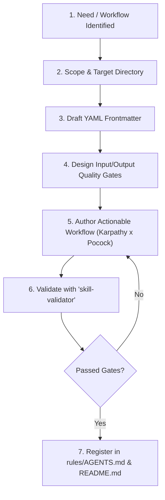

# Skill Creator (AEF Standard)

This skill guides human developers and autonomous agents in creating robust, deterministic, and safe agent skills that adhere to the **Agentic Engineering Framework (AEF)** principles.

---

## 🛠️ Step-by-Step Creation Workflow



### Step 1: Clarify Trigger & Capability Boundaries
- What exact problem does this skill solve?
- What are the precise keyword triggers when an AI agent should automatically invoke it?
- Avoid overly broad descriptions that trigger accidentally.

### Step 2: Choose Target Scope
- **Repository Scope**: `skills/<skill-name>/SKILL.md` (for framework-level distribution).
- **Project Scope**: `.agents/skills/<skill-name>/SKILL.md` (for project-specific workflows).
- **Global Scope**: `~/.gemini/config/skills/<skill-name>/` (requires explicit human permission).

### Step 3: Write Canonical Frontmatter
```yaml
---
name: my-new-skill
description: Specific 1-2 sentence description explaining WHAT the skill does and the EXACT trigger scenarios when it must be used.
---
```
*Rule: `name` must match the directory name identically in lowercase `kebab-case`.*

### Step 4: Define Output Gates & Rules
Never leave criteria implicit. Every skill must define:
- What conditions declare the task complete?
- What are the non-negotiable constraints (e.g. read-only mode, no production mutations without approval)?

### Step 5: Author Step-by-Step Workflow
- Structure in sequential numbered steps.
- Enforce **Karpathy's Ground Truth**: Require real terminal commands or tests to verify work.
- Enforce **Pocock's Grilling**: Require interactive questions if input requirements are ambiguous.
- Keep in technical **English**.

### Step 6: Validate Compliance
Run the verification check before committing:
```powershell
powershell.exe -ExecutionPolicy Bypass -File scripts/validate-skills.ps1 -SkillPath "skills/my-new-skill/SKILL.md"
```

### Step 7: Register in Framework Catalogues
When merged into AEF:
1. Add entry to `rules/AGENTS.md` (Section 3).
2. Add entry and node to `README.md` (Canonical Skills Catalogue).
3. Document in `CHANGELOG.md`.
